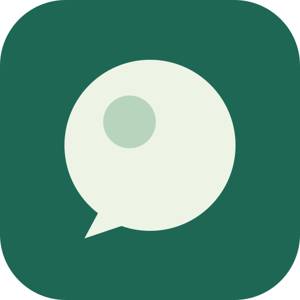
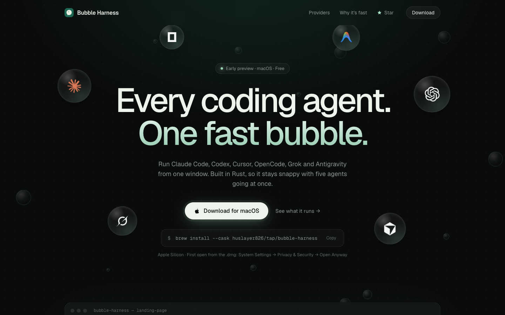
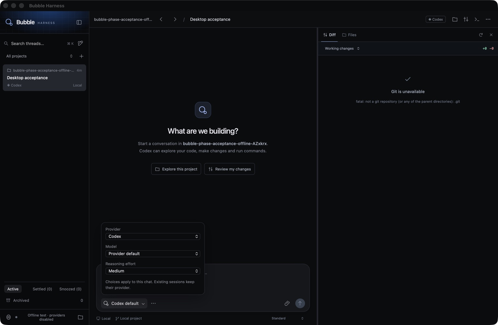

<p align="center">
  
</p>

<h1 align="center">Bubble Harness</h1>

<p align="center">
  <b>Every coding agent. One fast bubble.</b><br />
  A native desktop app for running Claude Code, Codex, Cursor, OpenCode, Grok and Antigravity side by side.
</p>

<p align="center">
  <a href="https://github.com/huslayer826/bubble-harness/releases/latest"></a>
  
  <a href="https://github.com/huslayer826/bubble-harness/stargazers"></a>
</p>

<p align="center">
  
</p>

## Download

**Homebrew** (recommended)

```sh
brew install --cask huslayer826/tap/bubble-harness
```

**Or download the [.dmg](https://github.com/huslayer826/bubble-harness/releases/latest/download/Bubble-Harness-arm64.dmg)** and drag Bubble Harness to Applications. The app isn't signed by Apple yet, so the first time you open it macOS will block it. Go to **System Settings → Privacy & Security** and click **Open Anyway**.

Requires an Apple Silicon Mac and [Node.js](https://nodejs.org) (Homebrew installs Node for you). It's free and an early preview.

## Bring your own sub

Bubble doesn't sell tokens. Sign in to the agents you already pay for and Bubble runs them for you.

| Agent | Sign in with |
| --- | --- |
| Claude Code | `claude auth login` |
| Codex | `codex login` |
| Cursor | `cursor-agent login` |
| OpenCode | `opencode auth login` |
| Grok | xAI account |
| Antigravity | Google sign-in |

Your logins stay on your Mac. Bubble talks to each agent's own CLI and never asks for an API key.

## Why it's fast

- **Rust core.** Storage, processes, Git and the terminal run natively in their own process. The UI never waits on them.
- **Close it, it keeps going.** Running turns, approvals and queued prompts survive the window closing. Reopen and you're caught up.
- **Race your models.** Send one prompt to several agents. Each gets its own Git worktree, so nothing collides.
- **Everything in one place.** Diffs, file browser, checkpoints and rewind, and a real terminal are all built in.

<p align="center">
  
</p>

## Built with

Rust · TypeScript · Tauri · SQLite · xterm.js

## FAQ

**Is it open source?**
No. The source is private. This repo holds releases, the website, the changelog and the issue tracker.

**Does my code leave my machine?**
Only the way it already does when you use these agents directly. Bubble runs locally and drives each agent's own CLI.

**Windows or Linux?**
Not yet. macOS first.

## Team

<table>
  <tr>
    <td align="center"><a href="https://github.com/huslayer826"><br /><b>Omar Yousef</b></a></td>
    <td align="center"><a href="https://github.com/seragy"><br /><b>Youssef Serag</b></a></td>
  </tr>
</table>

## Feedback

Found a bug or want a feature? [Open an issue](https://github.com/huslayer826/bubble-harness/issues/new/choose). If you like where this is going, a ⭐ helps a lot.

---

© 2026 Bubble Harness. All rights reserved. Product names and logos belong to their owners.
