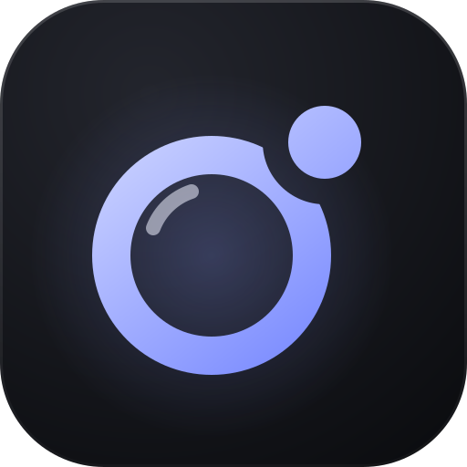
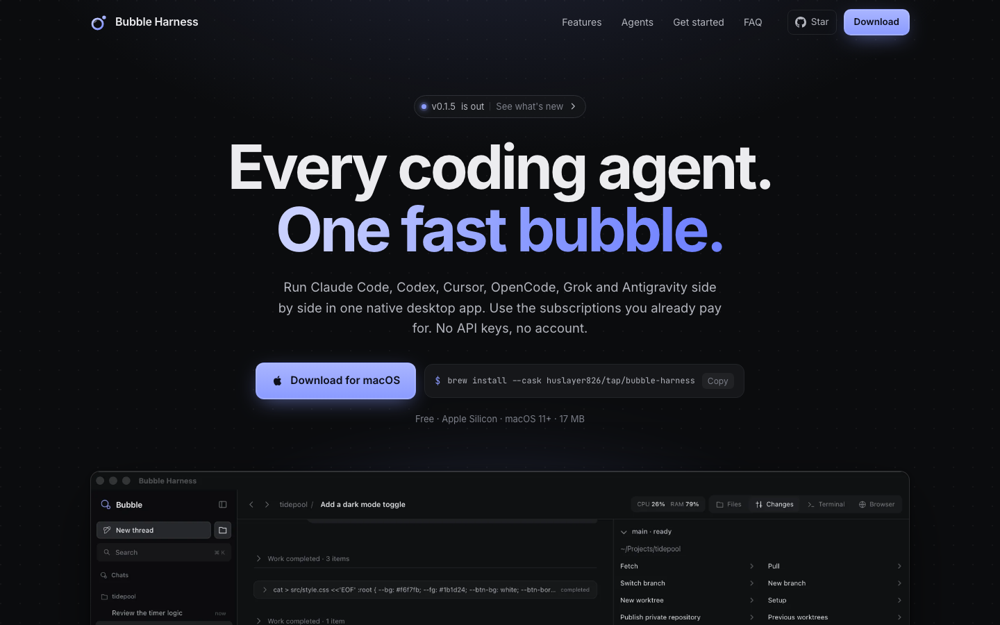
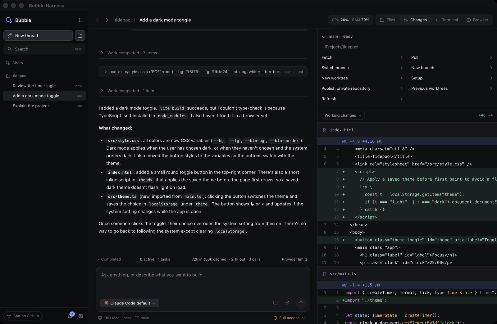

<p align="center">
  
</p>

<h1 align="center">Bubble Harness</h1>

<p align="center">
  <b>Every coding agent. One fast bubble.</b><br />
  A native desktop app for running Claude Code, Codex, Cursor, OpenCode, Grok and Antigravity side by side.
</p>

<p align="center">
  <a href="https://github.com/huslayer826/bubble-harness/releases/latest"></a>
  
  <a href="https://github.com/huslayer826/bubble-harness"></a>
</p>

<p align="center">
  
</p>

## Download

**Homebrew** (recommended)

```sh
brew install --cask huslayer826/tap/bubble-harness
```

**Or download the [.dmg](https://github.com/huslayer826/bubble-harness/releases/latest/download/Bubble-Harness-arm64.dmg)** and drag Bubble Harness to Applications. The app isn't signed by Apple yet, so the first time you open it macOS will block it. Go to **System Settings → Privacy & Security** and click **Open Anyway**.

**Requirements:** an Apple Silicon Mac on macOS 11 or later, [Node.js](https://nodejs.org) 22.12 or newer (Homebrew installs it for you), and at least one of the agents below. It's free and an early preview.

**Update** with `brew upgrade --cask bubble-harness`, or download the latest .dmg again. **Uninstall** with `brew uninstall --cask --zap bubble-harness` (the `--zap` also removes chats and settings).

## Bring your own sub

Bubble doesn't sell tokens. It runs the agents you already pay for, using their own command-line tools. **Install and sign in to at least one before you start:**

| Agent | Install | Sign in with |
| --- | --- | --- |
| Claude Code | [Install guide](https://docs.claude.com/en/docs/claude-code/setup) | `claude auth login` |
| Codex | [Install guide](https://github.com/openai/codex#installing-and-running-codex-cli) | `codex login` |
| Cursor | [Install guide](https://cursor.com/cli) | `cursor-agent login` |
| OpenCode (beta) | [Install guide](https://opencode.ai/docs) | `opencode auth login` |
| Grok (beta) | [Install guide](https://github.com/xai-org/grok-build#installing-the-released-binary) | xAI account |
| Antigravity (beta) | Installed from inside Bubble | Google sign-in |

Bubble checks which agents are installed and signed in when you first open it. Your logins stay on your Mac, and Bubble never asks for an API key.

## Why it's fast

- **Rust core.** Storage, processes, Git and the terminal run natively in their own process. The UI never waits on them.
- **Close it, it keeps going.** Running turns, approvals and queued prompts survive the window closing. Reopen and you're caught up.
- **Race your models.** Send one prompt to several agents. Each gets its own Git worktree, so nothing collides.
- **Everything in one place.** Diffs, file browser, checkpoints and rewind, and a real terminal are all built in.

<p align="center">
  
</p>

## Built with

Rust · TypeScript · Tauri · SQLite · xterm.js

## FAQ

**Is it open source?**
No. The source is private. This repo holds releases, the website, the changelog and the issue tracker.

**Does my code leave my machine?**
Only the way it already does when you use these agents directly: your prompts and code go to the agent you choose, nowhere else. Bubble has no account, no analytics and no server of its own. The only other request it makes is a daily check of this repo's GitHub releases for a new version, which you can turn off in Settings.

**Windows, Linux or Intel Macs?**
Not yet. Apple Silicon Macs first.

## Troubleshooting

**"Bubble Harness Not Opened" / "Apple could not verify…"**
The app isn't notarized by Apple yet. Open **System Settings → Privacy & Security**, scroll down and click **Open Anyway**. Installing with Homebrew avoids this.

**An agent shows "Not installed" but it is installed**
Bubble looks for agents on the same PATH as your terminal. If it still can't find one, open **Settings → General → Provider instances** and set the agent's **Executable path**.

**"Node.js 22.12 or newer is required"**
Every agent except Codex runs through Node.js. Install it from [nodejs.org](https://nodejs.org) or with `brew install node`, then reopen Bubble.

**Something else broke**
Choose **Help → Report a bug…** in the app. It opens an issue with your versions filled in; **Help → Copy diagnostics** gives you details to paste into it.

## Team

<table>
  <tr>
    <td align="center"><a href="https://github.com/huslayer826"><br /><b>Omar Yousef</b></a></td>
    <td align="center"><a href="https://github.com/seragy"><br /><b>Youssef Serag</b></a></td>
  </tr>
</table>

## Give it a try 🫧

Bubble is an early preview, and we're building it in the open. If you try it, please tell us how it went. Even a couple of sentences helps us decide what to build next.

- **[Share feedback](https://github.com/huslayer826/bubble-harness/issues/new?template=1-feedback.yml)**: what worked, what got in the way
- **[Report a bug](https://github.com/huslayer826/bubble-harness/issues/new?template=2-bug.yml)**: something broke
- **[Request a feature](https://github.com/huslayer826/bubble-harness/issues/new?template=3-feature.yml)**: something's missing

We read every one and reply on the issue.

<p align="center">
  <a href="https://github.com/huslayer826/bubble-harness"></a>
</p>

If Bubble saves you some time, a ⭐ helps other people find it.

---

© 2026 Bubble Harness. All rights reserved. Product names and logos belong to their owners.
